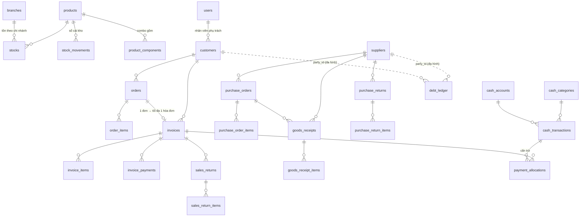

# Thiết kế cơ sở dữ liệu

**39 bảng · 17 enum · 85 khóa ngoại**, PostgreSQL 17. Nguồn sự thật là mã Drizzle ở [`apps/api/src/db/schema/`](../../apps/api/src/db/schema); ba file dưới đây được **sinh tự động**, đừng sửa tay.

| File                                       | Dùng để                                                                    | Mở bằng                                                   |
| ------------------------------------------ | -------------------------------------------------------------------------- | --------------------------------------------------------- |
| [`schema.dbml`](schema.dbml)               | Xem **sơ đồ quan hệ (ERD)** và thuộc tính từng bảng                        | dbdiagram.io, dbdocs, VS Code (extension "DBML Language") |
| [`data-dictionary.md`](data-dictionary.md) | **Từ điển dữ liệu**: cột, kiểu, null, mặc định, khóa ngoại, chỉ mục, CHECK | Trực tiếp trên GitHub/VS Code, không cần công cụ          |
| [`schema.sql`](schema.sql)                 | DDL đầy đủ để nạp vào PostgreSQL                                           | DBeaver, DataGrip, pgModeler, pgAdmin (ER diagram)        |

## Cách xem nhanh

1. **dbdiagram.io** (dễ nhất): vào <https://dbdiagram.io/d> → _Import_ → dán nội dung `schema.dbml`. Các bảng đã được gom nhóm (`TableGroup`) theo phân hệ nên kéo thả sơ đồ rất gọn.
2. **VS Code**: cài extension _DBML Language_ hoặc _dbml-viewer_, mở `schema.dbml`.
3. **DBeaver / pgAdmin / DataGrip**: tạo CSDL PostgreSQL rỗng, chạy `schema.sql`, rồi dùng chức năng _ER Diagram_ của công cụ. Hoặc, khi đã có Docker, `pnpm db:up` rồi `pnpm --filter @kiot/api db:migrate`.
4. **Drizzle Studio** (duyệt dữ liệu thật): `pnpm --filter @kiot/api db:studio` (cần CSDL đang chạy).

## Cập nhật khi đổi lược đồ

```bash
# trong apps/api, sau khi sửa src/db/schema/*.ts
pnpm db:generate --name mo_ta_ngan   # sinh migration SQL mới trong apps/api/drizzle/ → ĐỌC lại file SQL
pnpm db:docs                          # sinh lại schema.dbml, data-dictionary.md, schema.sql
```

Commit cùng lúc: mã lược đồ, file migration và ba file tài liệu. Mô tả tiếng Việt của bảng/cột nằm ở hai bảng `TABLE_NOTES` và `COLUMN_NOTES` trong [`export-docs.ts`](../../apps/api/src/db/export-docs.ts).

## Sơ đồ tổng quan (các quan hệ chính)



Đường nét đứt = quan hệ đa hình theo `party_type`, không có khóa ngoại thật.

## Nguyên tắc thiết kế cần nhớ

- **Tồn kho, công nợ, số dư quỹ không lưu thành cột tự do để sửa.** Mọi thay đổi ghi vào sổ cái chỉ-thêm (`stock_movements`, `debt_ledger`, `cash_transactions`) cùng transaction với chứng từ. Bảng `stocks` chỉ là số tồn hiện tại, có `CHECK (on_hand >= 0)`.
- **Công nợ khách = tổng `debt_ledger`** (không có cột nợ trong `customers`); **được phép âm** (khách trả dư).
- **Chứng từ không xóa**: hóa đơn, đơn, phiếu nhập/trả, phiếu thu/chi dùng `status` + `cancelled_at`. Danh mục (sản phẩm, khách, NCC…) dùng `deleted_at`.
- **Kiểu số:** tiền chứng từ `numeric(18,0)`; đơn giá/giá vốn `numeric(18,4)`; số lượng `numeric(14,3)`. API trả về dạng chuỗi.
- **Hóa đơn lưu bản sao** mã/tên/đơn vị/giá vốn của từng dòng tại thời điểm bán (`invoice_items`) để in lại và tính lãi gộp không bị ảnh hưởng khi sản phẩm đổi.
- **Khóa chính UUID** (`gen_random_uuid()`); PostgreSQL 17 chưa có uuidv7 gốc, đổi sang `uuidv7()` khi lên PostgreSQL 18.
- **Nhiều chi nhánh (Hà Nội, Sài Gòn):** xem mục "Nhiều chi nhánh" bên dưới.

## Sổ cái chỉ-thêm (CSDL ép bằng trigger)

Migration `0012` gắn trigger để CSDL tự từ chối, không phụ thuộc mã ứng dụng:

| Bảng                             | Được                                                                                                                    | Bị từ chối (`SQLSTATE LG001`)                                                                                         |
| -------------------------------- | ----------------------------------------------------------------------------------------------------------------------- | --------------------------------------------------------------------------------------------------------------------- |
| `stock_movements`, `debt_ledger` | `INSERT`                                                                                                                | `UPDATE`, `DELETE`, `TRUNCATE`                                                                                        |
| `cash_transactions`              | `INSERT`; `UPDATE` chỉ để **hủy phiếu** (`completed` → `cancelled` kèm `cancelled_at`, `cancel_reason`) hoặc sửa `note` | `DELETE`, `TRUNCATE`; đổi số tiền / quỹ / danh mục / đối tượng / thời điểm; sửa phiếu đã hủy; "hồi sinh" phiếu đã hủy |

Sai số liệu thì **thêm bút toán đảo**, không sửa dòng cũ. Giới hạn: chủ bảng hoặc siêu quản trị vẫn có thể `ALTER TABLE … DISABLE TRIGGER`; lớp này chặn mã viết sai và câu SQL sửa tay vô ý, không chặn người cố tình. Dev muốn làm sạch CSDL thì xóa cả volume Docker (`pnpm db:down` rồi xóa volume), đừng `TRUNCATE`.

## Tìm kiếm không dấu (tiếng Việt)

- Migration `0002_tim_khong_dau.sql` bật extension `unaccent` + `pg_trgm` và tạo hai hàm **IMMUTABLE**: `f_unaccent(text)` và `f_search_text(text)` (bỏ dấu + chữ thường: `"Đèn Lồng"` → `"den long"`).
- Chỉ mục GIN trigram trên biểu thức đã chuẩn hóa: `products_search_trgm` (mã + tên), `customers_search_trgm` và `suppliers_search_trgm` (mã + tên + số điện thoại).
- Trong mã dùng `searchWhere()` ([`apps/api/src/db/search.ts`](../../apps/api/src/db/search.ts)) với `productSearchExpr(products)` / `partySearchExpr(customers)`. Hàm tách từ khóa theo khoảng trắng, **mọi từ đều phải khớp** (thứ tự tùy ý), khớp một phần, và tự thoát ký tự `%`, `_`, `\`.
- **Không viết tay `LIKE`/`ILIKE` trên cột `name`** — sẽ không dùng được chỉ mục và không bỏ dấu. Biểu thức trong chỉ mục và trong truy vấn phải giống hệt nhau; `search.spec.ts` kiểm tra bằng `EXPLAIN`.
- Từ khóa dưới 3 ký tự không tận dụng được chỉ mục trigram (vẫn đúng kết quả, chỉ quét tuần tự); ở quy mô ~2.800 hàng / ~1.700 khách là không đáng kể.

## Nhiều chi nhánh (Hà Nội, Sài Gòn)

Hai chi nhánh dùng chung một hệ thống. **Dùng chung:** hàng hóa, khách hàng, nhà cung cấp, 7 hạng giá, danh mục thu chi. **Riêng từng chi nhánh:**

| Dữ liệu                                                                         | Nằm ở                                                                                     | Khóa chi nhánh                      |
| ------------------------------------------------------------------------------- | ----------------------------------------------------------------------------------------- | ----------------------------------- |
| Tồn kho, **giá vốn bình quân**, giá nhập cuối | `stocks` (khóa chính: chi nhánh, sản phẩm)                                                | `branch_id`                         |
| Công nợ khách / nhà cung cấp                                                    | `debt_ledger` — số dư = tổng theo (đối tác, chi nhánh); **tách biệt, không cấn trừ chéo** | `branch_id`                         |
| Hạn mức, kỳ hạn công nợ                                                         | `customer_branch_terms`                                                                   | `branch_id`                         |
| Đơn hàng, hóa đơn, trả hàng, phiếu nhập, sổ quỹ                                 | các bảng chứng từ, `cash_accounts`, `cash_transactions`                                   | `branch_id` (không đổi sau khi tạo) |
| Người dùng được vào chi nhánh nào                                               | `user_branches` (Quản lý thấy tất cả, không cần dòng)                                     | `branch_id`                         |

**Chuyển kho giữa 2 chi nhánh** (`stock_transfers`, `stock_transfer_items`, mã `CH`), hai bước:

1. **Gửi:** trừ tồn bên gửi theo giá vốn bên gửi; phiếu `in_transit` (hàng đang đi đường, không nằm trong tồn chi nhánh nào).
2. **Nhận:** cộng tồn bên nhận với **giá nhập = giá vốn bên gửi + phí vận chuyển phân bổ** (chia theo tỷ lệ giá trị từng dòng); tính lại giá vốn bình quân của bên nhận; ghi **công nợ đối ứng** — chi nhánh gửi coi chi nhánh nhận là khách (`customers.linked_branch_id`), chi nhánh nhận coi chi nhánh gửi là nhà cung cấp (`suppliers.linked_branch_id`). Số nợ = tiền hàng, cộng phí nếu bên gửi ứng tiền trả xe (`shipping_paid_by`).
3. Có thể **hủy** khi còn đang đi đường: trả hàng về kho bên gửi.

Phiếu chuyển kho **không phải hóa đơn bán** nên không vào doanh thu; **mọi báo cáo doanh số/công nợ phải loại các khách/nhà cung cấp có `linked_branch_id` khác rỗng**, và báo cáo gộp hai chi nhánh phải loại trừ công nợ nội bộ (nợ của SG với HN bù trừ với nợ của HN với SG).

**Điều khác cần biết:**

- Mọi thay đổi tồn kho đi qua `InventoryService.applyMovement` (`apps/api/src/modules/inventory`): khóa dòng tồn, không cho âm, cập nhật giá vốn bình quân của đúng chi nhánh, ghi sổ cái — cùng transaction với chứng từ.
- Các bảng mới `branch_id NOT NULL` (`debt_ledger`) chỉ thêm được vì lúc migrate chưa có dữ liệu; nếu sau này cần migrate khi đã có dữ liệu thì phải điền giá trị trước.
- Dữ liệu KiotViet hiện chỉ có 1 chi nhánh ("Chi nhánh trung tâm"); chi nhánh còn lại cũng đang ở KiotViet và sẽ nhập sau. Công cụ import cần tham số chi nhánh đích.

## Dữ liệu khởi tạo (seed)

`pnpm --filter @kiot/api db:seed` (sau `db:migrate`) nạp dữ liệu nền cần để hệ thống chạy. **Chạy lại bao nhiêu lần cũng an toàn:** chỉ thêm cái còn thiếu theo mã, không ghi đè thứ đã chỉnh (giá, tên, quyền, mật khẩu…). Nội dung nằm ở [`apps/api/src/db/seed/data.ts`](../../apps/api/src/db/seed/data.ts), có test.

| Nhóm               | Nội dung                                                                                                                                                                        |
| ------------------ | ------------------------------------------------------------------------------------------------------------------------------------------------------------------------------- |
| Chi nhánh          | `HN` Chi nhánh Hà Nội (mặc định) và `SG` Chi nhánh Sài Gòn                                                                                                                      |
| Khách/NCC nội bộ   | Mỗi chi nhánh có 1 khách hàng và 1 nhà cung cấp hệ thống (`CN-SG`, `CN-HN`) để chuyển kho coi chi nhánh kia là khách/nhà cung cấp                                               |
| Quỹ                | **4 quỹ**: "Tiền mặt" và "Ngân hàng" riêng cho từng chi nhánh (số dư đầu kỳ = 0, đặt lại khi cắt chuyển)                                                                        |
| Danh mục thu chi   | 15 danh mục, có `code` ổn định; 4 danh mục hệ thống (`customer_payment`, `supplier_refund`, `supplier_payment`, `customer_refund`)                                              |
| Bộ đếm mã chứng từ | `KH`, `NCC`, `DH`, `HD`, `TH`, `PDN`, `PN`, `THN`, `TT`, `CTM`, `CH` (chuyển kho) (6 chữ số) và `NV` (4 chữ số). Số bắt đầu = mã lớn nhất trong dữ liệu KiotViet 03/11/2026 + 1 |
| Thông tin công ty  | 1 dòng (tên lấy từ `SEED_COMPANY_NAME`, sửa sau trong Thiết lập)                                                                                                                |
| Quyền mặc định     | Cho 6 vai trò (trừ Quản lý) — chỉ khi bảng `role_permissions` còn trống                                                                                                         |
| Quản lý đầu tiên   | Tài khoản `NV0001` vai trò `manager`, **bắt buộc đổi mật khẩu** ở lần đăng nhập đầu; chỉ tạo khi hệ thống chưa có Quản lý nào                                                   |

**Mật khẩu Quản lý đầu tiên:** không có mật khẩu mặc định nào trong mã nguồn. Đặt `SEED_ADMIN_PASSWORD` (≥ 10 ký tự) trong `.env`, hoặc để trống để hệ thống **sinh ngẫu nhiên và ghi vào `apps/api/.seed-admin-credentials.txt`** (git bỏ qua, quyền 0600) — không in ra màn hình. Đăng nhập, đổi mật khẩu rồi xóa file đó. Mật khẩu được băm bằng argon2id.

**Việc phải làm khi cắt chuyển khỏi KiotViet:** cập nhật `CODE_SEQUENCES` (bộ đếm mã) theo số liệu mới nhất và đặt số dư đầu kỳ của quỹ, kẻo mã mới trùng mã cũ. Chưa biết khách hạng "Mới" (trong dữ liệu cũ) dùng bảng giá nào nên chưa seed bảng giá riêng cho hạng này.

**Cấp mã chứng từ trong mã:** dùng `nextDocumentCode(tx, 'HD')` (`apps/api/src/db/code-sequence.ts`) bên trong transaction của chứng từ — nguyên tử, không trùng khi nhiều yêu cầu cùng lúc, rollback thì trả lại số.

## Chưa có trong lược đồ (sẽ thêm khi cần)

- ~~Tìm không dấu~~ → **đã có** (xem mục "Tìm kiếm không dấu" ở trên).
- Phase 2: kiểm kho, đặt hàng nhập, quy đổi đơn vị, bản sửa hóa đơn `.nn` (đã có sẵn cột `root_invoice_id`/`revision_no`), phân bổ chi phí nhập hàng.
