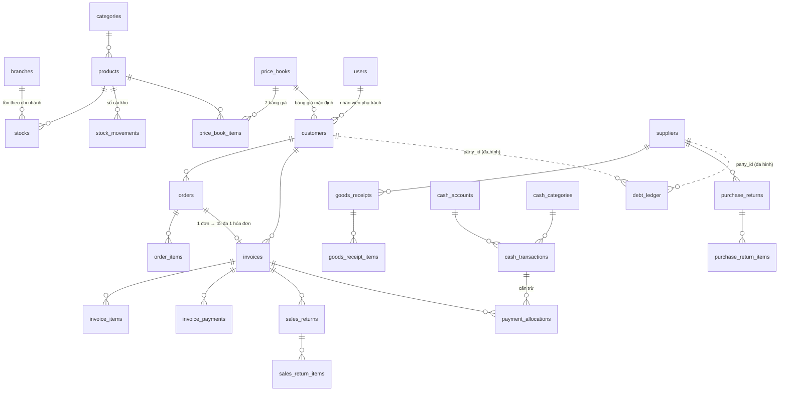

# Thiết kế cơ sở dữ liệu

**34 bảng · 14 enum · 70 khóa ngoại**, PostgreSQL 17. Nguồn sự thật là mã Drizzle ở [`apps/api/src/db/schema/`](../../apps/api/src/db/schema); ba file dưới đây được **sinh tự động**, đừng sửa tay.

| File                                       | Dùng để                                                                    | Mở bằng                                                   |
| ------------------------------------------ | -------------------------------------------------------------------------- | --------------------------------------------------------- |
| [`schema.dbml`](schema.dbml)               | Xem **sơ đồ quan hệ (ERD)** và thuộc tính từng bảng                        | dbdiagram.io, dbdocs, VS Code (extension "DBML Language") |
| [`data-dictionary.md`](data-dictionary.md) | **Từ điển dữ liệu**: cột, kiểu, null, mặc định, khóa ngoại, chỉ mục, CHECK | Trực tiếp trên GitHub/VS Code, không cần công cụ          |
| [`schema.sql`](schema.sql)                 | DDL đầy đủ để nạp vào PostgreSQL                                           | DBeaver, DataGrip, pgModeler, pgAdmin (ER diagram)        |

## Cách xem nhanh

1. **dbdiagram.io** (dễ nhất): vào <https://dbdiagram.io/d> → _Import_ → dán nội dung `schema.dbml`. Các bảng đã được gom nhóm (`TableGroup`) theo phân hệ nên kéo thả sơ đồ rất gọn.
2. **VS Code**: cài extension _DBML Language_ hoặc _dbml-viewer_, mở `schema.dbml`.
3. **DBeaver / pgAdmin / DataGrip**: tạo CSDL PostgreSQL rỗng, chạy `schema.sql`, rồi dùng chức năng _ER Diagram_ của công cụ. Hoặc, khi đã có Docker, `pnpm db:up` rồi `pnpm --filter @kiot/api db:migrate`.
4. **Drizzle Studio** (duyệt dữ liệu thật): `pnpm --filter @kiot/api db:studio` (cần CSDL đang chạy).

## Cập nhật khi đổi lược đồ

```bash
# trong apps/api, sau khi sửa src/db/schema/*.ts
pnpm db:generate --name mo_ta_ngan   # sinh migration SQL mới trong apps/api/drizzle/ → ĐỌC lại file SQL
pnpm db:docs                          # sinh lại schema.dbml, data-dictionary.md, schema.sql
```

Commit cùng lúc: mã lược đồ, file migration và ba file tài liệu. Mô tả tiếng Việt của bảng/cột nằm ở hai bảng `TABLE_NOTES` và `COLUMN_NOTES` trong [`export-docs.ts`](../../apps/api/src/db/export-docs.ts).

## Sơ đồ tổng quan (các quan hệ chính)



Đường nét đứt = quan hệ đa hình theo `party_type`, không có khóa ngoại thật.

## Nguyên tắc thiết kế cần nhớ

- **Tồn kho, công nợ, số dư quỹ không lưu thành cột tự do để sửa.** Mọi thay đổi ghi vào sổ cái chỉ-thêm (`stock_movements`, `debt_ledger`, `cash_transactions`) cùng transaction với chứng từ. Bảng `stocks` chỉ là số tồn hiện tại, có `CHECK (on_hand >= 0)`.
- **Công nợ khách = tổng `debt_ledger`** (không có cột nợ trong `customers`); **được phép âm** (khách trả dư).
- **Chứng từ không xóa**: hóa đơn, đơn, phiếu nhập/trả, phiếu thu/chi dùng `status` + `cancelled_at`. Danh mục (sản phẩm, khách, NCC…) dùng `deleted_at`.
- **Kiểu số:** tiền chứng từ `numeric(18,0)`; đơn giá/giá vốn `numeric(18,4)`; số lượng `numeric(14,3)`. API trả về dạng chuỗi.
- **Hóa đơn lưu bản sao** mã/tên/đơn vị/giá vốn của từng dòng tại thời điểm bán (`invoice_items`) để in lại và tính lãi gộp không bị ảnh hưởng khi sản phẩm đổi.
- **Khóa chính UUID** (`gen_random_uuid()`); PostgreSQL 17 chưa có uuidv7 gốc, đổi sang `uuidv7()` khi lên PostgreSQL 18.
- **Nhiều chi nhánh:** chứng từ và tồn kho có `branch_id` (hiện chỉ có 1 chi nhánh).

## Chưa có trong lược đồ (sẽ thêm khi cần)

- **Tìm không dấu** (`unaccent` + `pg_trgm`): cần tạo extension và chỉ mục GIN bằng migration viết tay ngay khi có CSDL thật; hiện chỉ có chỉ mục thường.
- Dữ liệu khởi tạo (seed): 7 bảng giá, vai trò/tài khoản chủ, danh mục thu chi, quỹ tiền mặt, chi nhánh trung tâm, bộ đếm mã chứng từ.
- Phase 2: kiểm kho, đặt hàng nhập, quy đổi đơn vị, bản sửa hóa đơn `.nn` (đã có sẵn cột `root_invoice_id`/`revision_no`), phân bổ chi phí nhập hàng.
